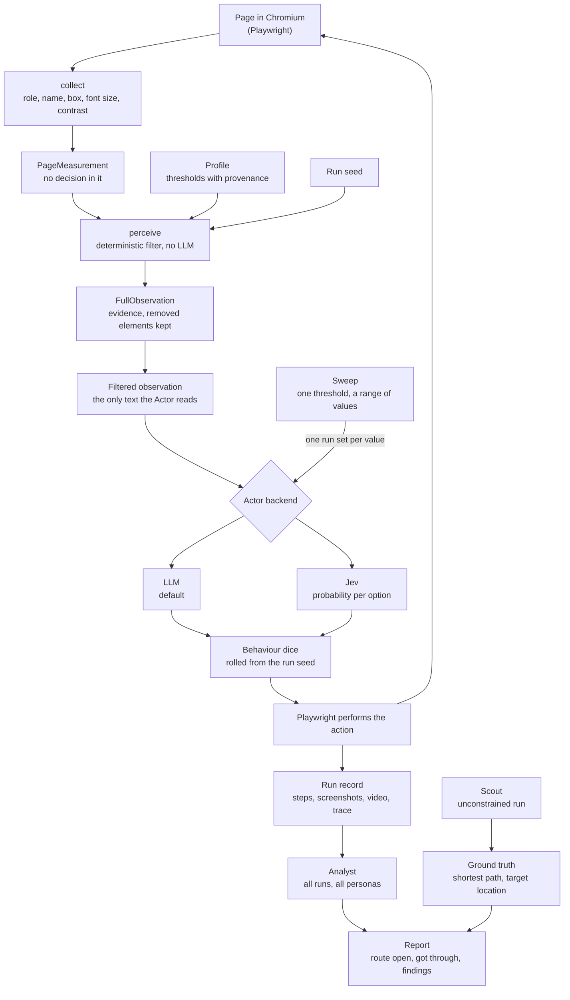

# Wayford

[](https://github.com/CShark-Hub/promptozaury/actions/workflows/ci.yml)

Wayford walks a web application within the limits of a declared capability profile, and shows where that profile got stuck.

The question is not "does it work". The question is **who does it work for**.

> The persona is a filter, not a prompt.
> The Actor must be our own loop.
> Claim less than you'd like to.

## Contents

- [What it is, and what it is not](#what-it-is-and-what-it-is-not)
- [Why it exists](#why-it-exists)
- [How it works](#how-it-works)
- [The personas](#the-personas)
- [The screens](#the-screens)
- [Quick start](#quick-start)
- [Commands](#commands)
- [Repository layout](#repository-layout)
- [Development](#development)
- [Documentation](#documentation)
- [Contributing](#contributing)
- [Project status](#project-status)
- [The name](#the-name)
- [Prior art and acknowledgements](#prior-art-and-acknowledgements)
- [Licence](#licence)

## What it is, and what it is not

Give Wayford an application URL, a goal in one sentence ("you want to see what you ordered three months ago") and one or more capability profiles. It runs an agent on that goal once per persona and seed, and reports at what capability level the goal stops being reachable, with evidence a developer can reproduce.

| Wayford is | Wayford is not |
|---|---|
| A boundary measurement: the threshold from which fewer than half of a persona's runs get through | A prediction of how real people behave |
| A hypothesis generator about wayfinding, with every finding linked to its evidence | A replacement for user research |
| A filter in code between the browser and the model, the same for every run with the same seed | A prompt that asks a model to pretend |
| A tool for product teams, UX designers and accessibility specialists | A pass/fail regression suite, a CI gate or an API tester |

A capability here is more than legibility. What a persona knows, how much of a page it takes in and how much it remembers can close a route too. A route closed only by those is one no page scanner reports.

## Why it exists

Scanners tell you whether a page is readable. Test bots tell you whether a flow passes. Neither tells you who the flow works for.

Tools that simulate users with a language model usually describe the persona in the prompt: "you are 72 and have poor eyesight". The model then plays a part, and nobody can check what it was given. Wayford takes another route. A persona is a set of thresholds, and those thresholds decide what reaches the model at all. Three mechanisms carry the project, and we found no existing tool with them:

1. **A perception filter enforced in code.** A deterministic layer between Playwright and the model's context. An element below the persona's threshold for contrast, font size or target size never reaches the model. There is no LLM in this layer.
2. **A seed.** Every perception decision and every behaviour roll is drawn from the run seed. With the same seed, an element gets the same perception decision every time, so a finding is a reproducible bug report rather than an anecdote.
3. **A capability sweep.** Wayford moves one threshold step by step over a fixed seed set and finds the first value at which fewer than half the runs get through: a number for a feature.

### What we claim, and what we do not

The claim is narrow on purpose: *under these assumptions, this route is closed. Check the assumptions, and the rest follows.*

- **Two numbers per persona, never one.** *Route open* is the share of seeds in which the filter left a way to the goal. It is deterministic. *Got through* is the share of runs in which the agent reached the goal. It depends on the agent. The gap between them is a hypothesis about wayfinding, not a measurement of a person.
- **A model with reduced input is not a person.** It reasons as well as ever, with less input. A person compensates: leans in, zooms, asks someone. The model does not, unless a rule adds it.
- **Narration is after the fact.** The agent's "I clicked twice because..." is written after the click. Wayford measures behaviour in code and leaves the model only interpretation, labelled as such.
- **What replays.** Perception decisions and behaviour rolls replay from the seed. A live model's answers may not, which is why a result is a rate over ten seeds rather than one run.

## How it works



Each step of a run goes round the loop once:

1. **Measure.** The collector runs in the page and measures every control and text block: a stable key, its role and name, its box, its computed font size and its contrast against the effective background. The result is a `PageMeasurement` with no decision in it.
2. **Filter.** `perceive(measurement, profile, seed)` applies the persona's rules in a fixed order and returns the step's observation. It is pure and browser-safe, so the Actor, the Lens and the sweep all call the same function.
3. **Decide.** The Actor reads the filtered observation as text and picks an action. Its prompt is word for word the same for every persona, and a test fails if the prompt template describes a persona. The Actor has two backends: an LLM (the default) or Jev, a decision model that returns a probability per option, from which the action is drawn with the run seed ([ADR 0001](docs/adr/0001-jev-actor-backend.md)).
4. **Act.** Behaviour rules may change the action (a click becomes a double click), each roll logged with its value. Playwright performs it, and the step is stored with its screenshot, observation, action and timestamp.

Around the loop:

- **Scout** walks each goal with no limits and records the ground truth: the shortest path it found and where the target is. The Actor has no access to it, and a test fails if its code path imports it. It is how the report tells "the feature is broken" from "the feature works, and this persona did not find it".
- **The Analyst** is a separate pass over every run of every persona on a goal. The agent never grades its own work. The numbers and the `deterministic` findings are written in code; the Analyst writes recommendations and `hypothesis` findings into fixed fields, never free prose.
- **axe-core** scans each target-app page once, and the report can cite a violation as a `measurement` finding.
- **The sweep** runs one run set per value of one threshold, reusing the same seeds at every value, and marks the boundary.

### The filter pipeline

The order is fixed. Stages 1 to 6 shape the observation, stage 7 shapes the action. Every rule and its source is in [`docs/RULES.md`](docs/RULES.md), "The pipeline".

| Stage | What it decides |
|---|---|
| 1. Viewport | What is on screen at all |
| 2–3. Perception and degradation | What can be seen, and how well |
| 4. Knowledge | What it means |
| 5. Attention | What gets noticed, and how much |
| 6. Memory | What the Actor still remembers |
| 7. Behaviour | What happens to the chosen action |

An element ends up in one of three states: **visible** (passed through), **degraded** (passed through with part of its name masked) or **invisible** (removed from what the Actor reads, kept in the evidence). A soft threshold has a band below it, where the state is decided by a roll taken once per element per run from `hash(run seed, element key)`.

Randomness follows three rules, on purpose:

| Layer | Rule | Why |
|---|---|---|
| Perception | Resolved once per element per run | Rolling per step would make the same button flicker in and out of view. No person sees that way, and no bug report could be reproduced. |
| Behaviour | Rolled on every action | A habit such as double-clicking applies to each action anew. |
| Knowledge | Fully deterministic | A persona knows a pattern or does not. |

## The personas

A persona is a capability bundle, not a job title and not a diagnosis. Its initial names the dimension it is defined by. Ada, the control, comes first, Zoya, the far end of the scale, last, and the three in between sort alphabetically. The fixtures are in [`packages/core/src/fixtures/profiles/`](packages/core/src/fixtures/profiles/).

| Persona | Defined by | The bundle, in short |
|---|---|---|
| **Ada** | **A**ll clear | Nothing switched on: every element passes, every pattern known, nothing capped. If Ada fails, the Actor or the app is broken, not the filter. |
| **Kai** | **K**nowledge | Sees everything Ada sees. Does not know several interface patterns (hamburger, kebab, breadcrumb, tabs, accordion), knows only everyday shop words, takes in 11 elements at a time and keeps the last 2 steps in mind. |
| **Milo** | **M**obile and motor | On a phone, with a 44 px target threshold and no contrast rule. |
| **Vera** | **V**ision | Soft contrast threshold of 3.0:1, a 16 px font threshold and a 32 px target threshold (`folk`). Hamburger, kebab and breadcrumb unknown, and a click turns into a double click with probability 0.8 (`folk`). |
| **Zoya** | **Z**, the far end | Every perception threshold strict (7.0:1 contrast, 24 px font, 48 px targets), every pattern unknown, 5 elements of attention and 2 steps of memory. |

No order here is a severity score: thresholds on different metrics do not compare. The demo's cast is Ada, Kai and Vera.

### Provenance

Every threshold carries the source it rests on, so the report can say which findings are hard and which are hypotheses. Some of the ids:

| Id | What it means |
|---|---|
| `wcag22` | W3C WCAG 2.2: the 4.5:1, 3:1 and 7:1 contrast anchors, the 24 px and 44 px target anchors |
| `fitts` | Fitts's law, in MacKenzie's 1992 formulation |
| `pisarek` | The Pisarek fog index, for Polish readability |
| `hig`, `material` | Apple's 44 pt and Google's 48 dp touch targets |
| `folk` | No source. Used where a rule has none, such as "some people double-click everything" |
| `llm` | Generated by a model |

A finding whose basis includes `folk` or `llm` keeps its type but is marked soft, with its source shown, and is never presented as hard. The full registry is at the bottom of [`docs/RULES.md`](docs/RULES.md).

## The screens

The web app is built on the design system in [`docs/DESIGN.md`](docs/DESIGN.md): a daylight measuring instrument with a cast. Persona colour means who, one orange marks every measurement line, and line style means certainty (solid measured, dashed hypothesis, dotted soft).

| Screen | Route | What it shows |
|---|---|---|
| Cast | `/cast` | The five personas and their capability bundles |
| Lens | `/lens` | The page as the persona's filter leaves it: visible, degraded (hatched, masked name) or removed. Thresholds as gauges, the evidence one switch away, axe's result for the page |
| Race | `/race` | Three to five personas live on one goal, each with its latest screenshot and the agent's narration. A race keeps its URL, `/race/$raceId`, so leaving it or a reload loses nothing, and the History under the start panel lists every race, running ones first |
| Report | `/report/$taskId` | Per persona over the seed set: route open, got through and median time, and the findings grouped by certainty, each opening its evidence |
| Run detail | `/runs/$runId` | One run step by step: the screenshot beside the text the model read, the action, the dice, Jev's options and draw, and the video and trace downloads |
| Runs | `/runs` | Every run, filtered by goal, persona and outcome |

`/` opens the Cast. The Lens needs no seeded data: io measures the target app live, and the Lens falls back to a stored measurement when the app is down.

## Quick start

### Prerequisites

- Node 24 or newer (the version in [`.node-version`](.node-version)).
- pnpm 12 (`npm install -g pnpm`; the exact version is the `packageManager` field in [`package.json`](package.json)).
- Chromium for Playwright, installed below.
- For runs on a real model: an OpenRouter key, or any OpenAI-compatible key. **The path below needs none.**

### Install

```bash
git clone https://github.com/CShark-Hub/promptozaury.git
cd promptozaury
pnpm install
pnpm --filter @wayford/agent exec playwright install --only-shell chromium   # once per machine
cp .env.example .env
```

Both `.env.example` and `.env` sit at the repository root. The variables io and the model adapter read:

| Variable | What it sets |
|---|---|
| `LLM_API_KEY` | The one key for every model role, Jev included. Required for io to boot (any value will do when no model is called, see below). |
| `LLM_BASE_URL` | An OpenAI-compatible endpoint. Defaults to OpenRouter. |
| `LLM_<ROLE>_MODEL`, `LLM_<ROLE>_TEMPERATURE`, `LLM_<ROLE>_EFFORT` | Per role: `EXTRACTOR`, `SCOUT`, `ACTOR`, `ANALYST`. Every role defaults to the team's build-time model. |
| `LLM_ACTOR_BACKEND` | `llm` (default) or `jev`. |
| `LLM_JEV_MODEL` | Jev's pinned model id. A floating alias is refused. |
| `PORT`, `LOG_LEVEL`, `DATABASE_URL` | io's port (3000), log level, and database (SQLite, `wayford.sqlite` at the repository root by default). |

### See it with data, without a key

`seed:demo --fake` fills the database with the demo's data on a fake Jev and a fake Analyst: no key, no network, no cost. It serves the target app on 5174 itself, so stop `pnpm dev` first.

```bash
pnpm --filter @wayford/io db:migrate   # creates wayford.sqlite; pnpm dev also does this at boot
pnpm seed:demo --fake                  # add --reset to empty runs, reports and sweeps first
LLM_API_KEY=x pnpm dev                 # io needs a key to boot; browsing calls no model
```

`pnpm dev` starts three processes:

| Process | Port | Open |
|---|---|---|
| web | 5173 | <http://localhost:5173> |
| io (HTTP API and SSE) | 3000 | `curl localhost:3000/health` |
| target-app (Quillmere, the demo shop) | 5174 | <http://localhost:5174> |

io answers `curl` and the web UI, never a page a browser opens on its own: a request naming another host, sent from another site, or a navigation the browser started itself is a 403. Its Chromium opens pages nobody vetted, and none of them may reach io (`docs/adr/0003-any-target.md`, D7).

Then open the Cast, the Lens on `/deliveries`, the Report for the hard goal and a run from Runs. The Race starts live runs, so it needs a real key.


*The target app, not Wayford: the hard goal's "Order archive" link at `?contrast=2` (the default), 3, 4.5 and 7. The query parameters tune the app; the Lens and the sweep move the persona's thresholds and leave the app fixed. More in [`packages/target-app/README.md`](packages/target-app/README.md).*

### With a real key

Put the key in `.env` as `LLM_API_KEY`. Every command below calls a model and is billed, so check the key's balance first. Before seeding for real, run Scout so the report opens with its line:

```bash
pnpm --filter @wayford/agent scout   # ground truth for both goals
pnpm seed:demo --reset               # on Jev by default; --backend llm is the fallback
```

Seeded runs, sweeps and recordings use a production build of the target app rather than its dev server ([`docs/STACK.md`](docs/STACK.md), "Target app").

## Commands

Run from the repository root. The last column says whether a command calls a model.

| Command | What it does | Model |
|---|---|---|
| `pnpm dev` | io on 3000, web on 5173, target-app on 5174 | Only when a run starts |
| `pnpm test` | Vitest across every package, browser tests included | No |
| `pnpm test:unit` | The same, skipping `*.browser.test.ts` | No |
| `pnpm lint` | Biome, which also enforces the package import rules | No |
| `pnpm typecheck` | `tsc` in every package | No |
| `pnpm seed:demo [--fake \| --backend llm\|jev] [--reset]` | Ada, Kai and Vera on both goals over seeds 1 to 10, a report per goal, one sweep per axis | Not with `--fake` |
| `pnpm --filter @wayford/io db:migrate` | Applies the migrations in `packages/io/drizzle/` | No |
| `pnpm --filter @wayford/io sweep -- --task <id> --persona <id> --axis <axis> --from <n> --to <n> --step <n> --seeds <a-b>` | One sweep, its value table and its boundary | Yes |
| `pnpm --filter @wayford/io analyse -- --task <id>` | The Analyst's report on a goal's stored runs | Yes |
| `pnpm --filter @wayford/agent scout` | Scout's ground truth for each goal | Yes |
| `pnpm --filter @wayford/agent run:one -- --persona <id> --task <id> --seed <n>` | One Actor run, by hand | Yes |
| `pnpm --filter @wayford/agent calibrate` | The calibration run from `docs/RULES.md` | Yes |
| `pnpm --filter @wayford/filter routes` | The route table: what the filter leaves on each route to the hard goal, per persona, seeds 1 to 100 | No |
| `pnpm --filter @wayford/web check:self` | Wayford's own screens measured at Vera's floors | No |

## Repository layout

A pnpm workspace of six packages under the `@wayford/*` scope, TypeScript and ESM throughout.

| Package | Owns |
|---|---|
| [`packages/core`](packages/core) | The seven contracts as zod schemas (`Profile`, `Task`, `RunResult`, `Finding`, `Observation`, `Action`, `RunEvent`), one full fixture each, the seeded random generator and ids |
| [`packages/filter`](packages/filter) | The collector and the perception filter: pure functions, zero LLM. `@wayford/filter/perceive` is its browser-safe entry |
| [`packages/agent`](packages/agent) | The LLM and Jev adapter, the Actor loop, Scout, behaviour dice and evidence capture |
| [`packages/io`](packages/io) | The HTTP API and SSE (Hono), the database (Drizzle over SQLite), the Extractor, the Analyst, the sweep, the axe-core sidecar and `seed:demo` |
| [`packages/web`](packages/web) | The React app: Vite, TanStack Router and Query, Tailwind, shadcn/ui |
| [`packages/target-app`](packages/target-app) | Quillmere, a small fictional shop with three routes to its hard goal and query parameters that tune it |

Beside them: [`docs/`](docs) for the plan, rules, design and decisions, and [`tasks/`](tasks) for the work items and the board.

Biome enforces the package import rules in `pnpm lint`; they are in [`docs/STACK.md`](docs/STACK.md), "Package import rules". The Actor's code path never imports Scout's output; a test walks its imports to check.

## Development

### Checks

```bash
pnpm lint
pnpm typecheck
pnpm test
```

Browser tests (`*.browser.test.ts`) launch Chromium through Playwright inside Vitest; `pnpm test:unit` skips them. No test calls a real model: the adapter has a fake that returns canned structured output.

`pnpm --filter @wayford/web check:self` runs Wayford's own collector over its own screens at 1280 × 720, in both themes, and fails on text under 4.5:1 or 16 px, or a control under 32 px. Wayford's own screens pass Vera's thresholds.

### CI

[`.github/workflows/ci.yml`](.github/workflows/ci.yml) runs `pnpm lint`, `pnpm typecheck` and `pnpm test` on every pull request and every push to `main`, on the Node version in `.node-version`, with Chromium installed for the browser tests.

### Determinism

- `Math.random()` outside the seeded generator fails lint. Use `rng(seed)` from `core`.
- Perception decisions are keyed by `hash(run seed, element key)`, never by DOM index, so a re-render does not change them.
- `Date.now()` never influences a decision, only timestamps.

### How work is organised

The team is four people working asynchronously; AI coding agents write most of the code, and humans direct and review it.

- **Tasks.** Every unit of work is a file in [`tasks/`](tasks), sized for one agent session, with its context, interface, acceptance boxes and what is out of scope. [`tasks/BOARD.md`](tasks/BOARD.md) shows who owns what and its status.
- **Specs and plans.** An M or L task writes a spec in [`docs/specs/`](docs/specs) and a plan in [`docs/plans/`](docs/plans) before it is built. An S task's file is its spec.
- **Decisions.** A decision taken after the plan gets an ADR in [`docs/adr/`](docs/adr): context, rejected options, consequences.
- **Pull requests.** One per task, one reviewer who did not work on it, squash merged. `main` stays green.

## Documentation

| Document | What it holds |
|---|---|
| [`AGENTS.md`](AGENTS.md) | Product rationale, the untouchable core, what was rejected and why. Read it first, whether you are a person or an agent |
| [`KONCEPCJA.md`](KONCEPCJA.md) | The product concept, in Polish |
| [`docs/PLAN.md`](docs/PLAN.md) | Requirements F1 to F12 with acceptance criteria, hackathon scope, architecture |
| [`docs/RULES.md`](docs/RULES.md) | The filter pipeline, every rule with its source, the persona bundles, calibration |
| [`docs/DEMO.md`](docs/DEMO.md) | The 90-second demo script, and the words we do not use |
| [`docs/DESIGN.md`](docs/DESIGN.md) | The design system every screen follows; [`docs/design/`](docs/design) draws it |
| [`docs/STACK.md`](docs/STACK.md) | Exact library picks, ports, package import rules |
| [`docs/CONVENTIONS.md`](docs/CONVENTIONS.md) | Layout, naming, determinism rules, Definition of Done |
| [`docs/ROADMAP.md`](docs/ROADMAP.md) | Four weekly milestones, the dependency map, the cut order |
| [`docs/KICKOFF.md`](docs/KICKOFF.md) | How the four of us started, and the rules for running agents in parallel |
| [`docs/WHAT-NEXT.md`](docs/WHAT-NEXT.md) | Ideas beyond the hackathon scope |
| [`docs/adr/`](docs/adr) | Decisions: Jev as a second Actor backend, the redesign, any target for the finals |

## Contributing

1. Read [`AGENTS.md`](AGENTS.md), then [`docs/PLAN.md`](docs/PLAN.md), then the task file.
2. Pick an unowned task in [`tasks/BOARD.md`](tasks/BOARD.md) whose dependencies are merged. [`tasks/README.md`](tasks/README.md) has the steps.
3. Branch as `feature/<task-id>-<slug>`, do only what the task file says, and tick its acceptance boxes with evidence.
4. Open a pull request titled with the task id, using the [template](.github/pull_request_template.md). It needs `pnpm lint`, `pnpm typecheck` and `pnpm test` green, and one reviewer.

The conventions and the Definition of Done are in [`docs/CONVENTIONS.md`](docs/CONVENTIONS.md). Everything is in English: code, comments, fixtures, UI copy. Check a change against the untouchable core in `AGENTS.md`: a persona that becomes a prompt, or a model inside the filter, undoes what the project is for.

## Project status

Wayford is a hackathon project, built in September and October 2026 by a team of four in four weekly milestones. The live status is in [`tasks/BOARD.md`](tasks/BOARD.md).

Out of scope for the hackathon: pass/fail regression, CI pipelines, accounts, export, native mobile apps (Milo is a phone viewport in Chromium), API testing, MCP, and a profile builder.

## The name

Wayford is a real place, a village on the River Axe in Somerset. The name comes from Old English *weġ* ("way, road") and *ford*: the point where a road crosses water.

A ford is the oldest capability threshold there is. The current is the same for everyone; whether you cross depends on your height, your footing, your nerve. Nobody changes the river. What changes is who is trying to cross it.

There is one interface. The question is who gets across it. The name also carries the two ideas the tool is built on: **wayfinding**, how people reach a destination, and **affordance**, what an interface offers relative to the capabilities of the person in front of it.

## Prior art and acknowledgements

Wayford builds its own engine. These shaped it:

- **[UXAgent](https://github.com/neuhai/UXAgent)** (MIT, arXiv 2504.09407). The closest match: personas, Playwright, batch runs, questionnaires, screenshots. There the persona is a prompt, with no capability model, no thresholds, no perception filtering and no seed. Our inspiration, not our base.
- **[PersonaLayer](https://github.com/PersonaLayer).** 45 UX profiles aligned with WCAG 2.2, used to adapt pages rather than test them. A checklist for the dimensions we model, cited as `personalayer` where thresholds match.
- **[axe-core](https://github.com/dequelabs/axe-core)** and other static scanners, which analyse code and colour without an agent loop. Wayford runs axe-core beside its own measurement.
- **Testing agents** such as Momentic, QA.tech and testRigor take a scenario and return pass or fail, with no persona.
- The sources behind every threshold: W3C WCAG 2.2, Fitts and MacKenzie, Nielsen Norman Group, Cowan, OECD PIAAC and the others in the registry in [`docs/RULES.md`](docs/RULES.md).

Built with [Playwright](https://playwright.dev), [Hono](https://hono.dev), [Drizzle](https://orm.drizzle.team), [zod](https://zod.dev), [React](https://react.dev), [TanStack](https://tanstack.com), [Tailwind CSS](https://tailwindcss.com), [shadcn/ui](https://ui.shadcn.com), [culori](https://culorijs.org), [Vitest](https://vitest.dev) and [Biome](https://biomejs.dev).

## Licence

No licence has been chosen yet. Until one is added, the code is not licensed for reuse.
