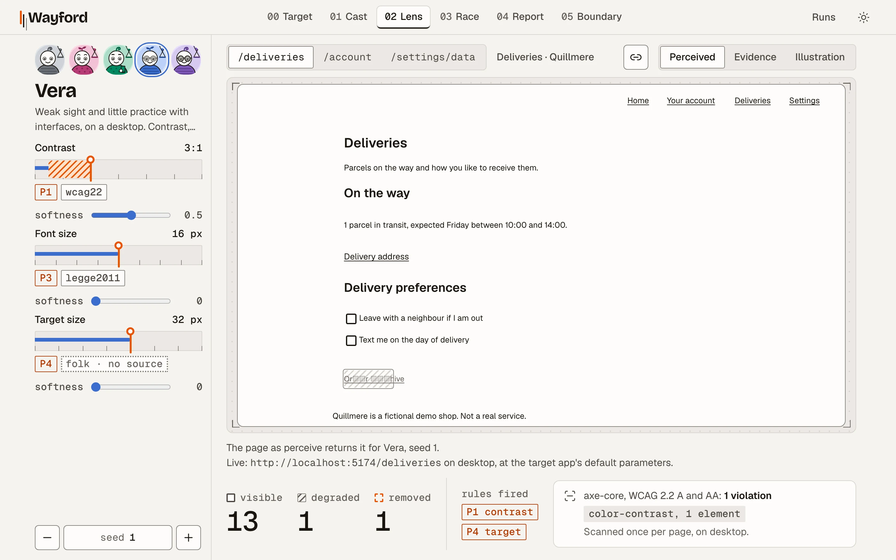

<div align="center">

<picture>
  <source media="(prefers-color-scheme: dark)" srcset="docs/assets/wordmark-dark.png">
  
</picture>

**Wayford walks a web application within the limits of a declared capability profile, and shows where that profile got stuck.**

The question is not "does it work". The question is **who does it work for**.

*The persona is a filter, not a prompt.*<br>
*The Actor must be our own loop.*<br>
*Claim less than you'd like to.*

[](https://github.com/CShark-Hub/wayford/actions/workflows/ci.yml)
[](LICENSE)


[Quick start](#quick-start) · [Usage](#usage) · [What next](docs/WHAT-NEXT.md) · [How it works](docs/HOW-IT-WORKS.md) · [Development](docs/DEVELOPMENT.md) · [Documentation](#documentation)

</div>

<br>

<picture>
  <source media="(prefers-color-scheme: dark)" srcset="docs/assets/lens-vera-dark.webp">
  
</picture>

<p align="center"><sub>The Lens: the demo shop's Deliveries page as Vera's filter leaves it. The low-contrast "Order archive" link reaches the model with part of its name masked.</sub></p>

## What is Wayford?

Give Wayford an application URL, a goal in one sentence ("you want to see what you ordered three months ago") and one or more capability profiles. It runs an agent on that goal once per persona and seed, and reports at what capability level the goal stops being reachable, with evidence a developer can reproduce.

| Wayford is | Wayford is not |
|---|---|
| A boundary measurement: the threshold from which fewer than half of a persona's runs get through | A prediction of how real people behave |
| A hypothesis generator about wayfinding, with every finding linked to its evidence | A replacement for user research |
| A filter in code between the browser and the model, the same for every run with the same seed | A prompt that asks a model to pretend |
| A tool for product teams, UX designers and accessibility specialists | A pass/fail regression suite, a CI gate or an API tester |

Out of scope: pass/fail regression, a CI gate, API testing and MCP as the foundation. Not planned: accounts, export, native mobile apps (Milo is a phone viewport in Chromium), more than one project, a profile builder, running in a CI pipeline and a thin MCP layer on top.

### What makes it different

- **A persona is a filter, not a prompt.** Thresholds for contrast, font size, target size, known interface patterns, attention and memory decide in code what reaches the model, what reaches it masked and what never does. There is no LLM in that layer.
- **Every run replays from its seed.** The same seed gives every element the same perception decision, so a finding is a reproducible bug report, not an anecdote.
- **It finds the boundary.** A sweep moves one threshold step by step over a fixed seed set and names the first value at which fewer than half the runs get through: a number for a feature.
- **It tells broken from hard to find.** Scout walks each goal with no limits, so the report can separate "the feature is broken" from "the feature works, and this persona did not find it".
- **Every finding opens its evidence.** Findings are grouped by certainty (measurement, deterministic, hypothesis), and each opens what it rests on. A run opens step by step: the screenshot beside the text the model read, the action, the dice, the video and the trace.

### Meet the cast

Five personas ship with Wayford. Each one is a bundle of thresholds, not a character to play, and its initial names the dimension it is defined by.

| | Persona | In one line |
|:-:|---|---|
| <picture><source media="(prefers-color-scheme: dark)" srcset="docs/assets/personas/ada-dark.svg"></picture> | **Ada**<br><sub>All clear, the control</sub> | Sees everything, knows every pattern, nothing capped. If Ada fails a goal, the Actor or the app is broken, not the filter. |
| <picture><source media="(prefers-color-scheme: dark)" srcset="docs/assets/personas/kai-dark.svg"></picture> | **Kai**<br><sub>Knowledge</sub> | Sees the page clearly on a desktop, but does not know several common interface patterns or shop jargon, takes in a handful of things at a time and keeps only the last couple of steps in mind. |
| <picture><source media="(prefers-color-scheme: dark)" srcset="docs/assets/personas/milo-dark.svg"></picture> | **Milo**<br><sub>Mobile and motor</sub> | Proficient and in a hurry, on a phone. Controls smaller than 44 px are cut from what Milo is shown. |
| <picture><source media="(prefers-color-scheme: dark)" srcset="docs/assets/personas/vera-dark.svg"></picture> | **Vera**<br><sub>Vision</sub> | Weak sight and little practice with interfaces, on a desktop. Faint text, small print and small targets reach Vera partly masked or not at all. |
| <picture><source media="(prefers-color-scheme: dark)" srcset="docs/assets/personas/zoya-dark.svg"></picture> | **Zoya**<br><sub>The far end</sub> | Every dimension at once: strict sight, no interface vocabulary, five things of attention and two steps of memory. |

<sub>Each avatar is drawn from its profile: glasses for a contrast threshold, a phone for a mobile device, an hourglass for the time budget.</sub>

Their full bundles, the loop and the claim Wayford makes are in [How it works](docs/HOW-IT-WORKS.md).

## Quick start

Wayford runs on your own machine, and nothing is hosted. One command starts three local processes: the **web UI** you work in; **io**, the API behind it, which drives the browser and calls the models; and **Quillmere**, a small demo shop for the personas to try.

### What you need

- **Node.js 24 or newer.** Check with `node -v`.
- **pnpm 12.** Install it with `npm install -g pnpm`.
- **Git.**
- **A model key, for live runs only.** An [OpenRouter](https://openrouter.ai) key, or a key for any OpenAI-compatible endpoint. The demo data needs no key.

### 1. Install (once)

```bash
git clone https://github.com/CShark-Hub/wayford.git
cd wayford
pnpm install
pnpm --filter @wayford/agent exec playwright install --only-shell chromium
cp .env.example .env
```

The fourth command downloads the Chromium that the personas browse with. The last one creates `.env`, your local settings file.

### 2. Load the demo data (once, no key, no cost)

```bash
pnpm seed:demo --fake
```

This fills the local database with the demo's runs, reports and sweeps, using a fake model, in about a minute. While it runs it serves the demo shop on port 5174, so run it while Wayford is stopped. Add `--reset` to start over.

### 3. Start Wayford

Open `.env` and set `LLM_API_KEY`. Use your key, or any placeholder such as `demo` if you only want to browse the demo data: io does not start without a value. Then run:

```bash
pnpm dev
```

Keep this terminal open. Ctrl+C stops all three processes.

| Process | Address | What it is |
|---|---|---|
| web | <http://localhost:5173> | The UI. Open this one. |
| io | <http://localhost:3000> | The API behind the UI. It drives Chromium and calls the models. |
| Quillmere | <http://localhost:5174> | The demo shop the personas try to use. |

### 4. Look around

Open <http://localhost:5173>:

- **Cast**: the five personas and what each one's filter does.
- **Lens**: a page as one persona's filter leaves it. Try `/deliveries` with Vera.
- **Report**: what the runs on a goal found, each finding linked to its evidence.
- **Boundary**: the threshold at which a goal stops being reachable.
- **Runs**: every run, step by step.

The Target screen and the Race call a model, so they need a real key.

### Live runs with your own key

Put your key in `.env` as `LLM_API_KEY`, restart `pnpm dev`, and follow [Usage](#usage) from the Target screen. Every live run is billed, so check the key's balance first. Every setting `.env` takes is in [Configuration](docs/DEVELOPMENT.md#configuration).

To redo the demo data on a real model, stop `pnpm dev` first, then run:

```bash
pnpm --filter @wayford/agent scout
pnpm seed:demo --reset
```

### If something goes wrong

| You see | Do this |
|---|---|
| `LLM_API_KEY: missing` | Set `LLM_API_KEY` in `.env`. Any value works for the demo data. |
| `the target app could not be served on 5174` | Stop `pnpm dev`, then run `seed:demo` again. |
| `Chromium did not launch` | Run the `playwright install` command from step 1. |
| `EADDRINUSE` or "port already in use" | Another program holds 5173, 3000 or 5174. Stop it. |

## Usage

Checking a goal, Scout, the runs and the report call a model, so this needs a real key in `.env`. Start with `pnpm dev` and open <http://localhost:5173/target>.

1. **Describe the target** on the Target screen:
   - **start URL**: where every run starts. Any http(s) page with no login, cookie wall or bot check.
   - **goal**: what the person wants, not the way there. Write "you want to see what you ordered three months ago", not "click Deliveries, then Order archive".
   - **success**: how a run is judged, checked after every step. Either a URL pattern (a Playwright glob such as `**/orders/*`) or an element on the page (a CSS selector such as `#order-history`). You write it; the model never does.
2. **Check the goal.** io's Extractor takes screen names and clicks out of the sentence, shows what it took out, and stores the goal under an id. From then on the nav carries the target: Lens, Race and Report open on it, and the nav shows its host.
3. **Look before you run.** *Open in the Lens* shows the start page as each persona's filter leaves it. *Race on this goal* runs three to five personas live, with their screenshots and narration.
4. **Run Scout.** Scout walks the goal three times with every element in view. Run it before the run set, so the report can tell a broken goal from one a persona did not find.
5. **Run and report.** Pick the cast and 3 or 10 seeds, the same for every persona, and start the set. Keep the page open: when every run has ended, the Analyst writes the report, and *Open the report* leads to it.
6. **Find the boundary** from the command line, since the UI starts no sweep. Use the goal id the Target screen shows; the Boundary screen opens the stored sweep by its id.

   ```bash
   pnpm --filter @wayford/io sweep -- --task <id> --persona prof_vera --axis contrast --from 1.5 --to 4.5 --step 0.5 --seeds 1-3
   ```

Off the target app, every run is on the LLM (io refuses Jev there), the report shows no route-open number, and a run set of three seeds is the default. Logins, goals that write (a form that saves, a purchase), cookie banners, bot challenges, iframes and shadow DOM are out of scope: a site that needs any of them is swapped for another ([ADR 0003](docs/adr/0003-any-target.md)).

On the target app, `pnpm seed:demo` stores the demo's two goals with their runs, reports and sweeps, so the Report, the Boundary and Runs open with data and no form to fill. Every other command is in [Commands](docs/DEVELOPMENT.md#commands).

## What next

None of this is built yet. [What next](docs/WHAT-NEXT.md) holds every idea, with its source and its limits.

- A `wayford` CLI that AI agents and people can drive: JSON output, stable exit codes, no prompts.
- Your own key per role, and local models: a local model for the Actor, a strong API model for the Analyst.
- Jev in more places: on any site, and tagging the steps where a run got stuck.
- Behaviour sets for any persona: stray clicks, unintended scrolls, rage clicks, typos, the wrong field.
- Text beyond ASCII: emoji, any script, pasted text.
- Keyboard-only and screen-reader runs.

## Documentation

| Guide | What it holds |
|---|---|
| [How it works](docs/HOW-IT-WORKS.md) | The claim, the loop, the filter pipeline, the personas and their provenance, the screens |
| [Development](docs/DEVELOPMENT.md) | Configuration, every command, the packages, checks, CI and the determinism rules |
| [Contributing](CONTRIBUTING.md) | How work is organised, and how a change gets from a task to `main` |
| [Security](SECURITY.md) | Where to run Wayford, what a run touches, and how to report a vulnerability |
| [What next](docs/WHAT-NEXT.md) | Ideas for after the hackathon, each with its source and its limits |
| [About](docs/ABOUT.md) | Project status, the name, prior art and acknowledgements |

The plan, the rules, the design system and every decision behind them are indexed in [`docs/`](docs/README.md). Start with [`AGENTS.md`](AGENTS.md), whether you are a person or an agent.

## Contributing

Wayford is a hackathon project, built in September and October 2026 by a team of four; AI coding agents write most of the code, and humans direct and review it. Every change starts from an [issue](https://github.com/CShark-Hub/wayford/issues) and lands as one reviewed pull request. [`CONTRIBUTING.md`](CONTRIBUTING.md) has the steps.

## Team

| Name | GitHub |
|---|---|
| Marcin Kotas | [@marcinkotas](https://github.com/marcinkotas) |
| Tomasz Nowakowski | [@tnowakowski-cshark](https://github.com/tnowakowski-cshark) |
| Grzegorz Stysiak | [@gstysiak-cshark](https://github.com/gstysiak-cshark) |
| Dawid Trznadel | [@dawidtheshark](https://github.com/dawidtheshark) |

## Licence

Copyright (c) 2026 CSHARK Commit Hackathon Contributors

The contributors are the team above: Marcin Kotas, Tomasz Nowakowski, Grzegorz Stysiak and Dawid Trznadel.

Wayford is licensed under the [Apache License, Version 2.0](LICENSE). The licence covers the whole project from the repository's first commit (`e5b08aa`, 2026-09-17), including every commit made before the `LICENSE` file was added. The copyright notice and the team are also in [`NOTICE`](NOTICE), which a redistribution must carry, as section 4 of the licence asks.

Third-party files keep their own licences: the Inter typeface in [`packages/target-app/public/fonts/`](packages/target-app/public/fonts/) is under the SIL Open Font License 1.1, with its licence beside it, and every dependency installed by pnpm is under its own.

<br>

<p align="center"><sub>There is one interface. The question is who gets across it. <a href="docs/ABOUT.md#the-name">Why "Wayford"</a></sub></p>
