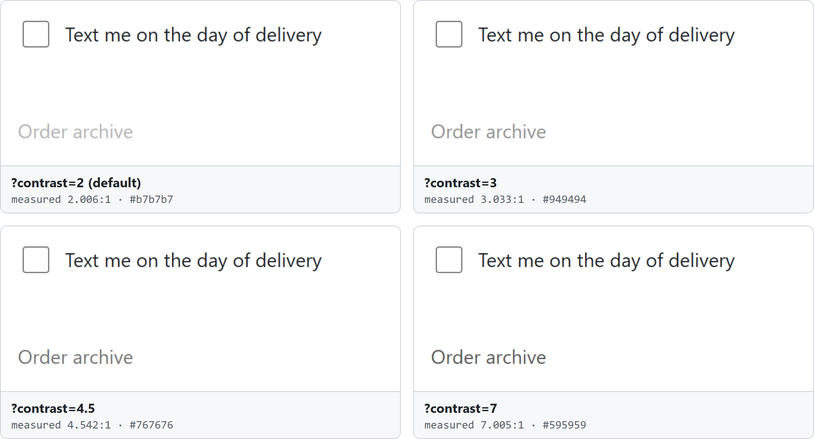

# Development

Everything you need to work on Wayford once it runs: configuration, every command, the packages, and the checks a change must pass. Installing it and a first run are in the [README](../README.md#quick-start); how work is organised and how to open a pull request are in [`CONTRIBUTING.md`](../CONTRIBUTING.md).

- [Configuration](#configuration)
- [Running locally](#running-locally)
- [Commands](#commands)
- [Repository layout](#repository-layout)
- [Checks](#checks)
- [Determinism](#determinism)

## Configuration

Both `.env.example` and `.env` sit at the repository root. The variables io and the model adapter read:

| Variable | What it sets |
|---|---|
| `LLM_API_KEY` | The one key for every model role, Jev included. Required for io to boot (any value will do when no model is called, as in the README's quick start). |
| `LLM_BASE_URL` | An OpenAI-compatible endpoint. Defaults to OpenRouter. |
| `LLM_<ROLE>_MODEL`, `LLM_<ROLE>_TEMPERATURE`, `LLM_<ROLE>_EFFORT` | Per role: `EXTRACTOR`, `SCOUT`, `ACTOR`, `ANALYST`. Every role defaults to the team's build-time model. |
| `LLM_ACTOR_BACKEND` | `llm` (default) or `jev`. |
| `LLM_JEV_MODEL` | Jev's pinned model id. A floating alias is refused. |
| `PORT`, `LOG_LEVEL`, `DATABASE_URL` | io's port (3000), log level, and database (SQLite, `wayford.sqlite` at the repository root by default). |

## Running locally

`pnpm dev` starts three processes:

| Process | Port | Open |
|---|---|---|
| web | 5173 | <http://localhost:5173> |
| io (HTTP API and SSE) | 3000 | `curl localhost:3000/health` |
| target-app (Quillmere, the demo shop) | 5174 | <http://localhost:5174> |

io answers `curl` and the web UI, never a page a browser opens on its own: a request naming another host, sent from another site, or a navigation the browser started itself is a 403. Its Chromium opens pages nobody vetted, and none of them may reach io ([ADR 0003](adr/0003-any-target.md), D7).

`pnpm seed:demo --fake` fills the database on a fake Jev and a fake Analyst: no key, no network, no cost. It serves the target app on 5174 itself, so stop `pnpm dev` first. Seeded runs, sweeps and recordings use a production build of the target app rather than its dev server ([`STACK.md`](STACK.md), "Target app").

### The target app



*The target app, not Wayford: the hard goal's "Order archive" link at `?contrast=2` (the default), 3, 4.5 and 7. The query parameters tune the app; the Lens and the sweep move the persona's thresholds and leave the app fixed. More in [`packages/target-app/README.md`](../packages/target-app/README.md).*

## Commands

Run from the repository root. The last column says whether a command calls a model.

| Command | What it does | Model |
|---|---|---|
| `pnpm dev` | io on 3000, web on 5173, target-app on 5174 | Only when a run starts |
| `pnpm test` | Vitest across every package, browser tests included | No |
| `pnpm test:unit` | The same, skipping `*.browser.test.ts` | No |
| `pnpm lint` | Biome, which also enforces the package import rules | No |
| `pnpm typecheck` | `tsc` in every package | No |
| `pnpm seed:demo [--fake \| --backend llm\|jev] [--reset]` | Ada, Kai and Vera on both goals over seeds 1 to 10, a report per goal, one sweep per axis | Not with `--fake` |
| `pnpm --filter @wayford/io db:migrate` | Applies the migrations in `packages/io/drizzle/` | No |
| `pnpm --filter @wayford/io sweep -- --task <id> --persona <id> --axis <axis> --from <n> --to <n> --step <n> --seeds <a-b>` | One sweep, its value table and its boundary | Yes |
| `pnpm --filter @wayford/io analyse -- --task <id>` | The Analyst's report on a goal's stored runs | Yes |
| `pnpm --filter @wayford/agent scout` | Scout's ground truth for each goal | Yes |
| `pnpm --filter @wayford/io scout -- --task <id>` | Scout on any stored goal, such as one from the Target screen | Yes |
| `pnpm --filter @wayford/agent run:one -- --persona <id> --task <id> --seed <n>` | One Actor run, by hand | Yes |
| `pnpm --filter @wayford/agent calibrate` | The calibration run from `docs/RULES.md` | Yes |
| `pnpm --filter @wayford/filter routes` | The route table: what the filter leaves on each route to the hard goal, per persona, seeds 1 to 100 | No |
| `pnpm --filter @wayford/web check:self` | Wayford's own screens measured at Vera's floors | No |

## Repository layout

A pnpm workspace of six packages under the `@wayford/*` scope, TypeScript and ESM throughout.

| Package | Owns |
|---|---|
| [`packages/core`](../packages/core) | The seven contracts as zod schemas (`Profile`, `Task`, `RunResult`, `Finding`, `Observation`, `Action`, `RunEvent`), one full fixture each, the seeded random generator and ids |
| [`packages/filter`](../packages/filter) | The collector and the perception filter: pure functions, zero LLM. `@wayford/filter/perceive` is its browser-safe entry |
| [`packages/agent`](../packages/agent) | The LLM and Jev adapter, the Actor loop, Scout, behaviour dice and evidence capture |
| [`packages/io`](../packages/io) | The HTTP API and SSE (Hono), the database (Drizzle over SQLite), the Extractor, the Analyst, the sweep, the axe-core sidecar and `seed:demo` |
| [`packages/web`](../packages/web) | The React app: Vite, TanStack Router and Query, Tailwind, shadcn/ui |
| [`packages/target-app`](../packages/target-app) | Quillmere, a small fictional shop with three routes to its hard goal and query parameters that tune it |

Beside them: [`docs/`](.) for the plan, rules, design and decisions, [`tasks/`](../tasks) for the work items and the board, and [`site/`](../site) for the landing page. It is one self-contained `index.html`, with no build step. [`pages.yml`](../.github/workflows/pages.yml) publishes that folder, and only that folder, to GitHub Pages on every push to `main` that changes it.

Biome enforces the package import rules in `pnpm lint`; they are in [`STACK.md`](STACK.md), "Package import rules". The Actor's code path never imports Scout's output; a test walks its imports to check.

## Checks

```bash
pnpm lint
pnpm typecheck
pnpm test
```

Browser tests (`*.browser.test.ts`) launch Chromium through Playwright inside Vitest; `pnpm test:unit` skips them. No test calls a real model: the adapter has a fake that returns canned structured output.

`pnpm --filter @wayford/web check:self` runs Wayford's own collector over its own screens at 1280 × 720, in both themes, and fails on text under 4.5:1 or 16 px, or a control under 32 px. Wayford's own screens pass Vera's thresholds.

### CI

[`.github/workflows/ci.yml`](../.github/workflows/ci.yml) runs `pnpm lint`, `pnpm typecheck` and `pnpm test` on every pull request and every push to `main`, on the Node version in `.node-version`, with Chromium installed for the browser tests.

Claude runs only when the team asks for it:

- **The review** waits on every push to a pull request until someone approves it: on the pull request, the Claude Code Review check → Details → Review deployments ([`claude-code-review.yml`](../.github/workflows/claude-code-review.yml)). The `claude-review` environment (Settings → Environments) lets the hackathon_promptozaury team approve, and any admin bypass. The check is not required, so a review nobody approves never blocks a merge. It reviews pull requests from this repository's branches, not from forks or drafts.
- **An `@claude` mention** in an issue, a pull request, a comment or a review gets a reply, for someone with the admin or maintain role on the repository ([`claude.yml`](../.github/workflows/claude.yml)). It stops before Claude starts for anyone else.

## Determinism

- `Math.random()` outside the seeded generator fails lint. Use `rng(seed)` from `core`.
- Perception decisions are keyed by `hash(run seed, element key)`, never by DOM index, so a re-render does not change them.
- `Date.now()` never influences a decision, only timestamps.

The rest of the conventions and the Definition of Done are in [`CONVENTIONS.md`](CONVENTIONS.md).
