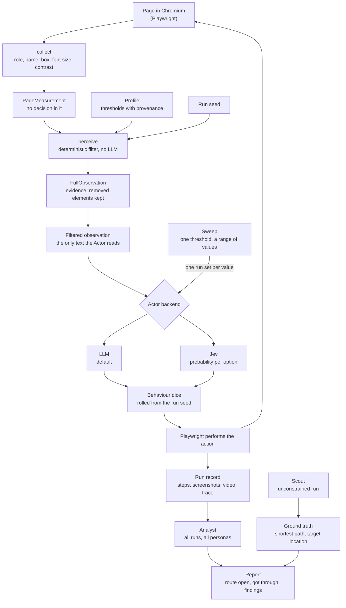
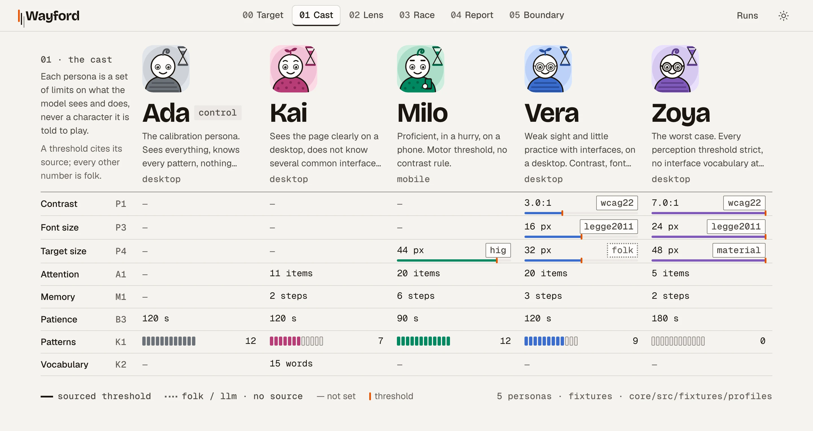

# How Wayford works

Wayford walks a web application within the limits of a declared capability profile, and shows where that profile got stuck. This page explains how: the claim it makes, the loop every run goes through, the filter at its centre, the personas and the screens.

What Wayford is and is not, and how to install and run it, is in the [README](../README.md). For the rules themselves, with every threshold and its source, see [`RULES.md`](RULES.md).

- [Why it exists](#why-it-exists)
- [What we claim, and what we do not](#what-we-claim-and-what-we-do-not)
- [The loop](#the-loop)
- [The filter pipeline](#the-filter-pipeline)
- [The personas](#the-personas)
- [The screens](#the-screens)

## Why it exists

Scanners tell you whether a page is readable. Test bots tell you whether a flow passes. Neither tells you who the flow works for.

Tools that simulate users with a language model usually describe the persona in the prompt: "you are 72 and have poor eyesight". The model then plays a part, and nobody can check what it was given. Wayford takes another route. A persona is a set of thresholds, and those thresholds decide what reaches the model at all. Three mechanisms carry the project, and we found no existing tool with them:

1. **A perception filter enforced in code.** A deterministic layer between Playwright and the model's context. An element below the persona's threshold for contrast, font size or target size never reaches the model. There is no LLM in this layer.
2. **A seed.** Every perception decision and every behaviour roll is drawn from the run seed. With the same seed, an element gets the same perception decision every time, so a finding is a reproducible bug report rather than an anecdote.
3. **A capability sweep.** Wayford moves one threshold step by step over a fixed seed set and finds the first value at which fewer than half the runs get through: a number for a feature.

A capability here is more than legibility. What a persona knows, how much of a page it takes in and how much it remembers can close a route too. A route closed only by those is one no page scanner reports.

The tools that came before, and what Wayford took from them, are in [`ABOUT.md`](ABOUT.md#prior-art-and-acknowledgements).

## What we claim, and what we do not

The claim is narrow on purpose: *under these assumptions, this route is closed. Check the assumptions, and the rest follows.*

- **Two numbers per persona, never one.** *Route open* is the share of seeds in which the filter left a way to the goal. It is deterministic. *Got through* is the share of runs in which the agent reached the goal. It depends on the agent. The gap between them is a hypothesis about wayfinding, not a measurement of a person.
- **A model with reduced input is not a person.** It reasons as well as ever, with less input. A person compensates: leans in, zooms, asks someone. The model does not, unless a rule adds it.
- **Narration is after the fact.** The agent's "I clicked twice because..." is written after the click. Wayford measures behaviour in code and leaves the model only interpretation, labelled as such.
- **What replays.** Perception decisions and behaviour rolls replay from the seed. A live model's answers may not, which is why a result is a rate over ten seeds rather than one run.

## The loop

Each step of a run goes round the loop once:

1. **Measure.** The collector runs in the page and measures every control and text block: a stable key, its role and name, its box, its computed font size and its contrast against the effective background. The result is a `PageMeasurement` with no decision in it.
2. **Filter.** `perceive(measurement, profile, seed)` applies the persona's rules in a fixed order and returns the step's observation. It is pure and browser-safe, so the Actor, the Lens and the sweep all call the same function.
3. **Decide.** The Actor reads the filtered observation as text and picks an action. Its prompt is word for word the same for every persona, and a test fails if the prompt template describes a persona. The Actor has two backends: an LLM (the default) or Jev, a decision model that returns a probability per option, from which the action is drawn with the run seed ([ADR 0001](adr/0001-jev-actor-backend.md)).
4. **Act.** Behaviour rules may change the action (a click becomes a double click), each roll logged with its value. Playwright performs it, and the step is stored with its screenshot, observation, action and timestamp.

Around the loop:

- **Scout** walks each goal with no limits and records the ground truth: the shortest path it found and where the target is. The Actor has no access to it, and a test fails if its code path imports it. It is how the report tells "the feature is broken" from "the feature works, and this persona did not find it".
- **The Analyst** is a separate pass over every run of every persona on a goal. The agent never grades its own work. The numbers and the `deterministic` findings are written in code; the Analyst writes recommendations and `hypothesis` findings into fixed fields, never free prose.
- **axe-core** scans each target-app page once, and the report can cite a violation as a `measurement` finding.
- **The sweep** runs one run set per value of one threshold, reusing the same seeds at every value, and marks the boundary.

## The filter pipeline

The order is fixed. Stages 1 to 6 shape the observation, stage 7 shapes the action. Every rule and its source is in [`RULES.md`](RULES.md), "The pipeline".

| Stage | What it decides |
|---|---|
| 1. Viewport | What is on screen at all |
| 2–3. Perception and degradation | What can be seen, and how well |
| 4. Knowledge | What it means |
| 5. Attention | What gets noticed, and how much |
| 6. Memory | What the Actor still remembers |
| 7. Behaviour | What happens to the chosen action |

An element ends up in one of three states: **visible** (passed through), **degraded** (passed through with part of its name masked) or **invisible** (removed from what the Actor reads, kept in the evidence). A soft threshold has a band below it, where the state is decided by a roll taken once per element per run from `hash(run seed, element key)`.

Randomness follows three rules, on purpose:

| Layer | Rule | Why |
|---|---|---|
| Perception | Resolved once per element per run | Rolling per step would make the same button flicker in and out of view. No person sees that way, and no bug report could be reproduced. |
| Behaviour | Rolled on every action | A habit such as double-clicking applies to each action anew. |
| Knowledge | Fully deterministic | A persona knows a pattern or does not. |

## The personas

<picture>
  <source media="(prefers-color-scheme: dark)" srcset="assets/cast-dark.webp">
  
</picture>

A persona is a capability bundle, not a job title and not a diagnosis. Its initial names the dimension it is defined by. Ada, the control, comes first, Zoya, the far end of the scale, last, and the three in between sort alphabetically. The fixtures are in [`packages/core/src/fixtures/profiles/`](../packages/core/src/fixtures/profiles/).

| Persona | Defined by | The bundle, in short |
|---|---|---|
| **Ada** | **A**ll clear | Nothing switched on: every element passes, every pattern known, nothing capped. If Ada fails, the Actor or the app is broken, not the filter. |
| **Kai** | **K**nowledge | Sees everything Ada sees. Does not know several interface patterns (hamburger, kebab, breadcrumb, tabs, accordion), knows only everyday shop words, takes in 11 elements at a time and keeps the last 2 steps in mind. |
| **Milo** | **M**obile and motor | On a phone, with a 44 px target threshold and no contrast rule. |
| **Vera** | **V**ision | Soft contrast threshold of 3.0:1, a 16 px font threshold and a 32 px target threshold (`folk`). Hamburger, kebab and breadcrumb unknown, and a click turns into a double click with probability 0.8 (`folk`). |
| **Zoya** | **Z**, the far end | Every perception threshold strict (7.0:1 contrast, 24 px font, 48 px targets), every pattern unknown, 5 elements of attention and 2 steps of memory. |

No order here is a severity score: thresholds on different metrics do not compare. The demo's cast is Ada, Kai and Vera.

### Provenance

Every threshold carries the source it rests on, so the report can say which findings are hard and which are hypotheses. Some of the ids:

| Id | What it means |
|---|---|
| `wcag22` | W3C WCAG 2.2: the 4.5:1, 3:1 and 7:1 contrast anchors, the 24 px and 44 px target anchors |
| `fitts` | Fitts's law, in MacKenzie's 1992 formulation |
| `pisarek` | The Pisarek fog index, for Polish readability |
| `hig`, `material` | Apple's 44 pt and Google's 48 dp touch targets |
| `folk` | No source. Used where a rule has none, such as "some people double-click everything" |
| `llm` | Generated by a model |

A finding whose basis includes `folk` or `llm` keeps its type but is marked soft, with its source shown, and is never presented as hard. The full registry is at the bottom of [`RULES.md`](RULES.md).

## The screens

The web app is built on the design system in [`DESIGN.md`](DESIGN.md): a daylight measuring instrument with a cast. Persona colour means who, one orange marks every measurement line, and line style means certainty (solid measured, dashed hypothesis, dotted soft).

The nav numbers the screens in the order the demo walks them, Target first; Runs sits apart.

| Screen | Route | What it shows |
|---|---|---|
| Target | `/target` | A site and a goal of your own: a start URL, the goal in one sentence and a success condition. Once the goal is checked, it opens the Lens and the Race on it, starts Scout and a run set, and the nav carries it to every screen that takes a target |
| Cast | `/cast` | The five personas and their capability bundles |
| Lens | `/lens` | The page as the persona's filter leaves it: visible, degraded (hatched, masked name) or removed. Thresholds as gauges, the evidence one switch away, axe's result for the page |
| Race | `/race` | Three to five personas live on one goal, each with its latest screenshot and the agent's narration. A race keeps its URL, `/race/$raceId`, so leaving it or a reload loses nothing, and the History under the start panel lists every race, running ones first |
| Report | `/report/$taskId` | Per persona over the seed set: route open, got through and median time, and the findings grouped by certainty, each opening its evidence |
| Boundary | `/boundary`, `/boundary/$sweepId` | One stored sweep: the boundary value in the headline, its two curves and its value table, each cell opening the runs behind it. `/boundary` opens the latest sweep on the hard goal, Vera's contrast by default or Kai's attention with `?axis=maxElements` |
| Run detail | `/runs/$runId` | One run step by step: the screenshot beside the text the model read, the action, the dice, Jev's options and draw, and the video and trace downloads |
| Runs | `/runs` | Every run, filtered by goal, persona and outcome |

`/` opens the Cast. The Lens needs no seeded data: io measures the target app live, and the Lens falls back to a stored measurement when the app is down.
