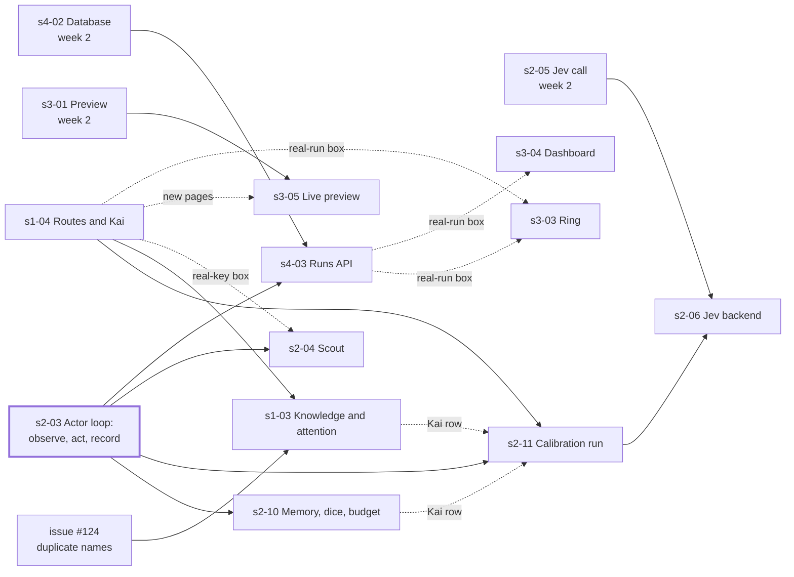
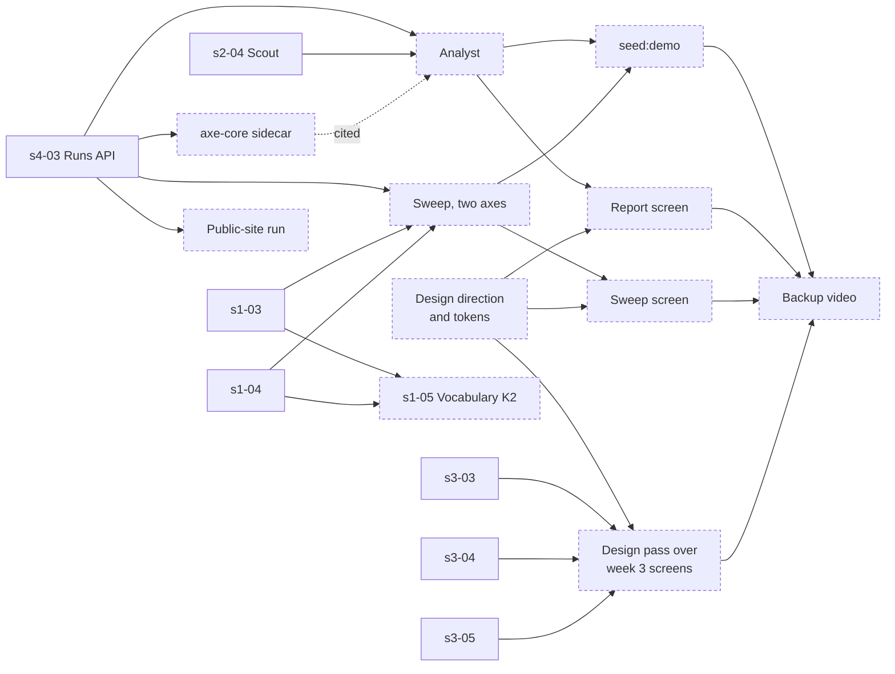

# ROADMAP — four weeks, 64 human hours

Capacity: 4 people × 4 h per week × 4 weeks. Humans direct and review, AI agents write code.
One human hour buys roughly one agent task of 1 to 3 hours of agent work plus review.
Budget: about 8 tasks per week, about 32 tasks total. The backlog must fit in that number.

Milestones are weekly. Exit criteria are commands or clicks, never sentences.

## Working model

- Every task is a file in `tasks/`. One task, one branch, one PR, one reviewer.
- Streams are areas of the code, not people. Nobody has to continue what they did the week before. No task is assigned to a person: whoever has time takes the next unowned task whose dependencies are merged. `tasks/BOARD.md` lists each week's tasks with what they wait on, and the dependency map below shows what can start after what.
- A human grabs a task by writing their name into `tasks/BOARD.md`, runs their agent on it, reviews the result, opens the PR.
- Changes to the filter contract (`packages/core/src/observation.ts`, `measurement.ts`, and `docs/RULES.md`) require two approvals within 48 h. Everything else needs one, the rest of `packages/core` included.
- One 30 minute sync per week. Everything else asynchronous, status in `tasks/BOARD.md`.
- Anything not merged by Friday of week 4 does not exist for the demo.

## Kickoff — before week 1 starts

Day 0, one person (the one who wrote the plan):

- Run `m0-01` with an agent and merge it. Roughly two hours. The kickoff call starts with a green skeleton, not a discussion about tooling.
- Create the OpenRouter key and set the budget cap, or name who does.

Kickoff call, 30 minutes, all four:

1. Objections to assumptions A1–A19 in `docs/PLAN.md`. Silence means accepted. (5 min)
2. Stream ownership. Stream 1 goes to the strongest deliverer. Record names in `tasks/BOARD.md`. (10 min)
3. Sketch the `Observation` shape together on a whiteboard. This is the only contract worth a synchronous conversation; everything else goes through PR review. (10 min)
4. Confirm hackathon rules, communication channel, weekly sync slot. (5 min)

Week 1 split, one person per stream, about 4 h each including reviews:

| Person | Future stream | Week 1 tasks | Why |
|---|---|---|---|
| A | 1 filter | `m0-03` Observation and Action | The filter owner writes the filter contract. |
| B | 2 agent loop | `m0-02` Profile, then `m0-05` RunEvent and RunResult | Profile does not depend on m0-03, so B starts immediately and picks up m0-05 when m0-03 merges. |
| C | 3 frontend | `m0-06` target app, then web half of `m0-07` | Pure HTML and CSS, zero dependencies, ready on day 1. |
| D | 4 input, output | `m0-04` Task and Finding, then API half of `m0-07`, `m0-08` with A | Task and Finding shape the Extractor and Analyst D will own. |

Schema tasks touch separate files in `packages/core/src`; the only shared file is the index re-export, so merge conflicts stay trivial.
Every PR gets one reviewer from a different stream. `m0-03` gets all three others within 48 h; that review replaces the "whole team over one file" hour from `KONCEPCJA.md`.

## Week 1 — M0: contracts frozen, skeleton runs

Everyone touches `packages/core` this week and nothing else depends on parallel work yet.

Exit criteria:

- `pnpm install && pnpm test` passes on every laptop.
- `packages/core` exports seven zod schemas: `Profile`, `Task`, `RunResult`, `Finding`, `Observation`, `Action`, `RunEvent`. Each has one full fixture that validates.
- `packages/target-app` serves a small app with CSS variables for contrast, font size and target size, and one deterministic path to a goal.
- `pnpm dev` starts API and web with an empty screen and a health endpoint.
- `tasks/` holds the week 2 backlog with owners.

## Week 2 — M1 filter standalone, M2 frontend on fixtures

Monday 2026-09-28 to Sunday 2026-10-04. Streams split. Nothing here needs an LLM key except the adapter smoke tests (`complete` and Jev's `decide`) and the Extractor's manual check.

Before it starts: the critical issues from the week 1 review (#13 to #16) are fixed, because they change the contracts every week 2 task builds on. `s1-01` and `s3-02` also need `rng` and `hash` in core, which issue #26 asks for, and `pnpm lint` must pass on `main` again (#55), because every task's acceptance runs it. Everything else the review found stays in its issue and is not a week 2 task.

Exit criteria:

- Filter: Playwright page in, `PageMeasurement` out; `PageMeasurement`, profile and seed in, `FullObservation` out. Collect-then-perceive twice on one target-app page, with the same profile and seed, gives identical output. Elements below a hard threshold are absent from the Actor's view and present in the evidence. Raising a perception threshold never gives an element a better state under that rule. Tests run without an LLM.
- Frontend: the preview screen runs `perceive` in the browser on the measurement fixture and redraws under 500 ms when a slider moves. Persona cards render fixture profiles with procedural avatars.
- LLM adapter: `complete()` returns a parsed object for a trivial schema through OpenRouter, cost logged.
- Jev: `smoke:jev` prints a probability per option for the fixture observation through OpenRouter, cost logged (`s2-05`, `docs/adr/0001-jev-actor-backend.md`). First to slip to week 3.
- Evidence: one persona on the target app gets a browser context with its device, a fake cursor, a screenshot per step, a `webm` and a `trace.zip` named after persona, seed and run id.
- Extractor: rejects a task with a path in it, accepts a clean one, produces a `Task`.
- Database: Drizzle tables for profiles, tasks and runs; migrations run; runs and tasks round-trip.

## Week 3 — M3 the product exists

Meeting point one: Actor with a real filtered observation, result on disk and in the database.

Tasks: `tasks/BOARD.md`, week 3, written in `m0-08` and widened on 2026-10-01. Ten tasks:

- the Actor loop in two parts, observe-act-record (`s2-03`) then memory, dice and budget (`s2-10`);
- the calibration run on the real model (`s2-11`);
- Scout (`s2-04`) and the runs API (`s4-03`);
- the ring, the dashboard and the live preview (`s3-03`, `s3-04`, `s3-05`);
- the target app's three routes with Kai (`s1-04`);
- the knowledge and attention stages (`s1-03`, without A3).

Live video and the ring's motion were cut.

Why the widening: with perception alone every persona is the same reader with part of the page removed, which is legibility, and a page scanner reports legibility without an agent. Kai and the routes closed by an unknown pattern, an unknown word or a crowded page are what make the result a question of who the page works for.

An eleventh, off the critical path: the Jev Actor backend (`s2-06`, `docs/adr/0001-jev-actor-backend.md`). It is no exit criterion. Its gate decides whether week 4 runs on Jev or on the LLM.

The issues `s2-03` waited on (#19, #31, #114) and #38 are fixed. `s1-03` waits on #124: a nav list item measured beside its own link spends two attention slots on one name.

Watch during the first real runs, from `tasks/m0-06-target-app.md` Follow-ups: dead buttons that may produce noisy findings, and the hamburger that never triggers K1 for a desktop persona (the kebab from `s1-04` does). The calibration table in `docs/RULES.md` is the first check that the engine works, and `s2-11` runs it on the real model: Ada near 10/10, Vera with her contrast cut made hard at 0/10 on the hard goal, and Vera's hard-goal successes never more than the seeds where the link reached her degraded.

Exit criteria:

- One command runs one persona on one task against the target app and writes a `RunResult`, a `webm` and a `trace.zip`.
- Same task, persona, run seed and fake Actor answers twice give identical filtered observations and dice rolls per step (`docs/PLAN.md` F5 AC1).
- `calibrate` (`s2-11`) on the real model: Ada at least 4/5 on both goals, the hard-cut Vera 0/5, and the table with Vera's and Kai's rows, routes and cost in its PR.
- Scout produces ground truth for both target-app goals, on the app with its three routes. The Actor package has no import from Scout output, enforced by a test.
- Ring shows 3 runs in parallel over SSE, avatars change state, each tile shows its latest step screenshot.
- Dashboard lists real runs with filters and opens run detail with replay.
- Preview switches from fixtures to the live filter on the target app.
- The hard goal has three routes. On `/settings/data` the filter measures no WCAG AA failure.
- `perceive` applies K1, K4 and A1: Kai's Actor text shows the kebab on `/account` as its bare role, and `routes` prints the table of what the filter leaves each persona on each route, matching `docs/RULES.md`.
- The 90-second demo script is written down.

## Week 4 — M4 report and sweep, M5 demo

Meeting point two: frontend on real analysis.

If `s2-06` passed its gate, the sweep and `seed:demo` run on the Jev backend; otherwise on the LLM.

Design pass. Weeks 1 to 3 build every screen function first, so the look is decided here and reworked hard: the personas, preview, arena, runs, run detail, report and sweep screens. It starts on Monday with a direction and the tokens, so the report and sweep screens built this week land in the new look rather than being reworked twice. `docs/PLAN.md` "UI" is the brief it starts from, and it may change. One constraint does not change: a tool that measures who an interface works for passes its own measurement.

Exit criteria:

- Analyst produces `Finding[]` over all runs for a task. The report screen renders them grouped by type with evidence links.
- Sweep over contrast on one path prints the boundary value and the chart shows the marker.
- Sweep over `maxElements` on Kai prints its boundary value the same way.
- K2: Kai reads "Fulfilment ledger" on `/settings/data` with its jargon masked as `[unfamiliar term]`.
- axe-core violations appear as measurement findings.
- `pnpm seed:demo` fills the database with 3 personas, 2 tasks, 10 runs each, one sweep per axis.
- Backup video of the full 90 second demo exists in the repo or a shared drive.
- One credibility run against a real public site is recorded.
- Every demo screen follows the reworked design.
- Wayford's own screens pass WCAG AA by the filter's own measurement: `collect` on each demo screen finds no text below 4.5:1 and no control below 24 px.

Stretch, if the above is done: A3, the option cap, cut from `s1-03` to fit week 3.

## Dependency map, weeks 3 and 4

What can start after what. Tasks merged before 2026-10-01 are left out, so a task with no arrow in can start now. A solid arrow means the task waits for the other to merge; a dashed one means only some of its acceptance boxes do. Week 4 is preliminary: its nodes are areas of work, not task files yet, and the map is redrawn when they are written. The task files' Depends on lines are the truth; update this map when one changes.

Week 3, with what is still open from week 2:

Week 4, preliminary, with the week 3 tasks it builds on:

Thick border: on `main` with every dependency merged on 2026-10-01, so it can start now. `s1-04`, `s3-03` and `s3-04` have no solid arrow in either; they join it once this plan merges. Dashed border: week 4, preliminary. Design direction has no dependency either; it is planned for week 4's Monday so the look is decided once the week 3 screens exist.

## Cut order if time runs out

Cut from the bottom, never from the top.

1. Perception filter, the knowledge and attention stages (K1, K4, A1), seed, live preview. Never cut.
2. Actor loop, run evidence, the calibration run, dashboard.
3. The target app's three routes and Kai (`s1-04`). Without them the demo has no route that only knowledge or attention closes.
4. Scout (`s2-04`). Without ground truth a report cannot tell a broken feature from one a persona could not find (`AGENTS.md`, "Scout is mandatory").
5. Boundary sweep on contrast.
6. Analyst report.
7. Design pass. Without it the demo runs on the week 3 look.
8. Vocabulary K2 (`s1-05`).
9. axe-core sidecar. The "no WCAG failure here, and Kai still did not get through" slide reads best with it; without it, the slide cites the filter's own measurement from `s1-04`.
10. Sweep on `maxElements`.
11. Ring. Live video and the motion are already cut; next the ring itself, in favour of the dashboard.
12. Jev Actor backend (`s2-06`). The LLM backend stays.
13. Real public site run.
