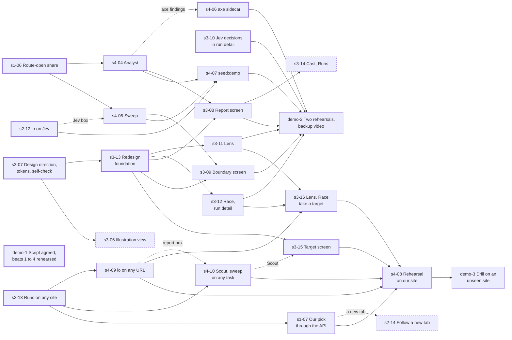

# ROADMAP — four weeks, 64 human hours

Capacity: 4 people × 4 h per week × 4 weeks. Humans direct and review, AI agents write code.
One human hour buys roughly one agent task of 1 to 3 hours of agent work plus review.
Budget: about 8 tasks per week, about 32 tasks total. The backlog must fit in that number.

Milestones are weekly. Exit criteria are commands or clicks, never sentences.

## Working model

- Every task is a file in `tasks/`. One task, one branch, one PR, one reviewer.
- Streams are areas of the code, not people. Nobody has to continue what they did the week before. No task is assigned to a person: whoever has time takes the next unowned task whose dependencies are merged. `tasks/BOARD.md` lists each week's tasks with what they wait on, and the dependency map below shows what can start after what.
- A human grabs a task by writing their name into `tasks/BOARD.md`, runs their agent on it, reviews the result, opens the PR.
- One reviewer for every PR, someone who did not work on the task. Until week 4, changes to the filter contract (`packages/core/src/observation.ts`, `measurement.ts`, and `docs/RULES.md`) took two approvals; from week 4 they take one, like everything else (decided 2026-10-04).
- One 30 minute sync per week. Everything else asynchronous, status in `tasks/BOARD.md`.
- Anything not merged by Tuesday 2026-10-13 does not exist for the demo or the finals, both on Wednesday 2026-10-14.

## Kickoff — before week 1 starts

Day 0, one person (the one who wrote the plan):

- Run `m0-01` with an agent and merge it. Roughly two hours. The kickoff call starts with a green skeleton, not a discussion about tooling.
- Create the OpenRouter key and set the budget cap, or name who does.

Kickoff call, 30 minutes, all four:

1. Objections to assumptions A1–A19 in `docs/PLAN.md`. Silence means accepted. (5 min)
2. Stream ownership. Stream 1 goes to the strongest deliverer. Record names in `tasks/BOARD.md`. (10 min)
3. Sketch the `Observation` shape together on a whiteboard. This is the only contract worth a synchronous conversation; everything else goes through PR review. (10 min)
4. Confirm hackathon rules, communication channel, weekly sync slot. (5 min)

Week 1 split, one person per stream, about 4 h each including reviews:

| Person | Future stream | Week 1 tasks | Why |
|---|---|---|---|
| A | 1 filter | `m0-03` Observation and Action | The filter owner writes the filter contract. |
| B | 2 agent loop | `m0-02` Profile, then `m0-05` RunEvent and RunResult | Profile does not depend on m0-03, so B starts immediately and picks up m0-05 when m0-03 merges. |
| C | 3 frontend | `m0-06` target app, then web half of `m0-07` | Pure HTML and CSS, zero dependencies, ready on day 1. |
| D | 4 input, output | `m0-04` Task and Finding, then API half of `m0-07`, `m0-08` with A | Task and Finding shape the Extractor and Analyst D will own. |

Schema tasks touch separate files in `packages/core/src`; the only shared file is the index re-export, so merge conflicts stay trivial.
Every PR gets one reviewer from a different stream. `m0-03` gets all three others within 48 h; that review replaces the "whole team over one file" hour from `KONCEPCJA.md`.

## Week 1 — M0: contracts frozen, skeleton runs

Everyone touches `packages/core` this week and nothing else depends on parallel work yet.

Exit criteria:

- `pnpm install && pnpm test` passes on every laptop.
- `packages/core` exports seven zod schemas: `Profile`, `Task`, `RunResult`, `Finding`, `Observation`, `Action`, `RunEvent`. Each has one full fixture that validates.
- `packages/target-app` serves a small app with CSS variables for contrast, font size and target size, and one deterministic path to a goal.
- `pnpm dev` starts API and web with an empty screen and a health endpoint.
- `tasks/` holds the week 2 backlog with owners.

## Week 2 — M1 filter standalone, M2 frontend on fixtures

Monday 2026-09-28 to Sunday 2026-10-04. Streams split. Nothing here needs an LLM key except the adapter smoke tests (`complete` and Jev's `decide`) and the Extractor's manual check.

Before it starts: the critical issues from the week 1 review (#13 to #16) are fixed, because they change the contracts every week 2 task builds on. `s1-01` and `s3-02` also need `rng` and `hash` in core, which issue #26 asks for, and `pnpm lint` must pass on `main` again (#55), because every task's acceptance runs it. Everything else the review found stays in its issue and is not a week 2 task.

Exit criteria:

- Filter: Playwright page in, `PageMeasurement` out; `PageMeasurement`, profile and seed in, `FullObservation` out. Collect-then-perceive twice on one target-app page, with the same profile and seed, gives identical output. Elements below a hard threshold are absent from the Actor's view and present in the evidence. Raising a perception threshold never gives an element a better state under that rule. Tests run without an LLM.
- Frontend: the preview screen runs `perceive` in the browser on the measurement fixture and redraws under 500 ms when a slider moves. Persona cards render fixture profiles with procedural avatars.
- LLM adapter: `complete()` returns a parsed object for a trivial schema through OpenRouter, cost logged.
- Jev: `smoke:jev` prints a probability per option for the fixture observation through OpenRouter, cost logged (`s2-05`, `docs/adr/0001-jev-actor-backend.md`). First to slip to week 3.
- Evidence: one persona on the target app gets a browser context with its device, a fake cursor, a screenshot per step, a `webm` and a `trace.zip` named after persona, seed and run id.
- Extractor: rejects a task with a path in it, accepts a clean one, produces a `Task`.
- Database: Drizzle tables for profiles, tasks and runs; migrations run; runs and tasks round-trip.

## Week 3 — M3 the product exists

Meeting point one: Actor with a real filtered observation, result on disk and in the database.

Tasks: `tasks/BOARD.md`, week 3, written in `m0-08` and widened on 2026-10-01. Ten tasks:

- the Actor loop in two parts, observe-act-record (`s2-03`) then memory, dice and budget (`s2-10`);
- the calibration run on the real model (`s2-11`);
- Scout (`s2-04`) and the runs API (`s4-03`);
- the ring, the dashboard and the live preview (`s3-03`, `s3-04`, `s3-05`);
- the target app's three routes with Kai (`s1-04`);
- the knowledge and attention stages (`s1-03`, without A3).

Live video and the ring's motion were cut.

Why the widening: with perception alone every persona is the same reader with part of the page removed, which is legibility, and a page scanner reports legibility without an agent. Kai and the routes closed by an unknown pattern, an unknown word or a crowded page are what make the result a question of who the page works for.

An eleventh, off the critical path: the Jev Actor backend (`s2-06`, `docs/adr/0001-jev-actor-backend.md`). It is no exit criterion. Its gate decides whether week 4 runs on Jev or on the LLM.

The issues `s2-03` waited on (#19, #31, #114) and #38 are fixed. `s1-03` waits on #124: a nav list item measured beside its own link spends two attention slots on one name.

Watch during the first real runs, from `tasks/m0-06-target-app.md` Follow-ups: dead buttons that may produce noisy findings, and the hamburger that never triggers K1 for a desktop persona (the kebab from `s1-04` does). The calibration table in `docs/RULES.md` is the first check that the engine works, and `s2-11` runs it on the real model: Ada near 10/10, Vera with her contrast cut made hard at 0/10 on the hard goal, and Vera's hard-goal successes never more than the seeds where the link reached her degraded.

Exit criteria:

- One command runs one persona on one task against the target app and writes a `RunResult`, a `webm` and a `trace.zip`.
- Same task, persona, run seed and fake Actor answers twice give identical filtered observations and dice rolls per step (`docs/PLAN.md` F5 AC1).
- `calibrate` (`s2-11`) on the real model: Ada at least 4/5 on both goals, the hard-cut Vera 0/5, and the table with Vera's and Kai's rows, routes and cost in its PR.
- Scout produces ground truth for both target-app goals, on the app with its three routes. The Actor package has no import from Scout output, enforced by a test.
- Ring shows 3 runs in parallel over SSE, avatars change state, each tile shows its latest step screenshot.
- Dashboard lists real runs with filters and opens run detail with replay.
- Preview switches from fixtures to the live filter on the target app.
- The hard goal has three routes. On `/settings/data` the filter measures no WCAG AA failure.
- `perceive` applies K1, K4 and A1: Kai's Actor text shows the kebab on `/account` as its bare role, and `routes` prints the table of what the filter leaves each persona on each route, matching `docs/RULES.md`.
- The team has agreed on the 90-second demo script, `docs/DEMO.md`.

## Week 4 — M4 report and sweep, M5 demo

Monday 2026-10-05 to Tuesday 2026-10-13, the merge cutoff; the demo and the finals are on Wednesday 2026-10-14. Week 3 finished a week early, so week 4 has seven working days: about eleven task slots at the plan's rate of eight a week. Tasks: `tasks/BOARD.md`, week 4.

Capacity, recounted on 2026-10-07:

- **Left:** five working days, about eight slots.
- **The demo:** every build task is done or in review. What it still needs is those reviews, `demo-1` and `demo-2`: about three slots.
- **Any target:** the table needs about eight slots, and its floor about five (`s2-13`, `s1-07`, `s4-09`, `s3-15`, `s3-16`).
- **So both fit only with more than 4 h per person.** The team plans for that (Tomasz, 2026-10-06). If it does not happen, the any-target table is what gets cut, from `demo-3` down to its floor: the Lens, the Race and a report on our own pick.

Meeting point two: frontend on real analysis.

Scope, agreed 2026-10-04 (`docs/PLAN.md`, "Hackathon scope"): what `docs/DEMO.md` shows, each piece in the simplest form that serves its beat, made to look finished.

- Analyst and report: the numbers and deterministic findings in code, the model writing recommendations and hypotheses (`s4-04`, `s3-08`).
- Sweep, one engine for both axes, and its screen (`s4-05`, `s3-09`), fed by one route-open function (`s1-06`).
- K2 (`s1-05`) and axe per page (`s4-06`) for beat 3.
- Jev, which passed its gate: io runs a run set on it (`s2-12`), and run detail shows its decisions (`s3-10`). The sweep and `seed:demo` run on Jev; the live race stays on the LLM, for its narration.
- Design: `s3-07` set a first direction. The redesign approved on 2026-10-06 replaces it (`docs/adr/0002-daylight-instrument-redesign.md`, `docs/DESIGN.md`), built in this order:
  - a foundation first (`s3-13`): tokens, themes, the top bar, the renamed routes;
  - then the Lens (`s3-11`) and the Race with run detail (`s3-12`);
  - the Report (`s3-08`) and Boundary (`s3-09`) screens built on it;
  - Cast and Runs last and optional (`s3-14`): the demo shows neither.
- `seed:demo` (`s4-07`), with a `--fake` mode that fills every screen with no key.
- Any target, for the finals (`docs/adr/0003-any-target.md`, added 2026-10-06): runs, the Lens, Scout and the report on a site entered on a new Target screen, and a sweep on it prepared with the CLI. Our pick goes through the API first, then a rehearsal through the UI. Taken after the demo tasks and before the optional ones; the 90-second demo does not wait on it.
- The demo: the script agreed by Friday 2026-10-09, two rehearsals and the backup video by Tuesday 2026-10-13.

Any target, for the finals, once every must task is taken: `s2-13`, then `s1-07` (our pick through the API), `s4-09`, `s4-10`, `s3-15` and `s3-16`, then the rehearsal `s4-08` and the drill `demo-3`. `s2-14` only if a run hits a new tab (`tasks/BOARD.md`).

Optional, once every must task and every any-target task is taken: `s3-14` (Cast and Runs redesigned), `s3-06` (illustration view), and the behaviour rules `s2-07` (B2), `s2-08` (B4) and `s2-09` (a simulated clock), in that order.

Exit criteria:

- `POST /reports/:taskId` stores a report over all runs of a task: per persona the route-open seeds beside the successes (F8 AC6), and findings of all three types, each linked to a step. The report screen renders them grouped by type.
- `sweep` on Vera's contrast and on Kai's `maxElements` prints each boundary value, and the Boundary screen shows both curves and the marker.
- K2: Kai reads "Fulfilment ledger" on `/settings/data` with its jargon masked as `[unfamiliar term]`.
- The Lens shows each target-app page's axe-core result, and the report cites axe violations as measurement findings.
- A Jev run's step replay shows the options, their probabilities and the drawn one.
- `pnpm seed:demo` fills the database with 3 personas, 2 tasks, 10 runs each, a report per task and one sweep per axis, and prints runs, wall time and cost. `--fake` does the same with no key.
- Every demo screen follows `docs/DESIGN.md`, and `pnpm --filter @wayford/web check:self` passes on each, in Daylight and Night. By the filter's own measurement there is:
  - no text below 4.5:1 or 16 px;
  - no control below 32 px.
- The demo runs end to end as `docs/DEMO.md` describes, rehearsed at least twice.
- Backup video of the full 90 second demo exists in the repo or a shared drive.

## Dependency map, week 4

What can start after what. Week 3 is merged, and so is `s1-05` (PR #162). A solid arrow means the task waits for the other to merge; a dashed one means only some of its acceptance boxes do. The task files' Depends on lines are the truth; update this map when one changes.

Thick border: can start Monday 2026-10-05, `s3-13` from Tuesday 2026-10-06, `s2-13` and `s3-15` from Wednesday 2026-10-07. Dashed border: optional, or `s2-14`, taken only if a run hits a new tab. The any-target tasks, `s2-13` to `demo-3`, are for the finals: the 90-second demo waits on none of them. `s2-07` to `s2-09` are optional too and wait on nothing open; they are left off the map.

## Cut order if time runs out

Cut from the bottom, never from the top.

1. Perception filter, the knowledge and attention stages (K1, K4, A1), seed, live preview. Never cut.
2. Actor loop, run evidence, the calibration run, dashboard.
3. The target app's three routes and Kai (`s1-04`). Without them the demo has no route that only knowledge or attention closes.
4. Scout (`s2-04`). Without ground truth a report cannot tell a broken feature from one a persona could not find (`AGENTS.md`, "Scout is mandatory").
5. Boundary sweep on contrast, with route-open share and its screen (`s1-06`, `s4-05`, `s3-09`), and the redesign foundation that screen is built on (`s3-13`).
6. Analyst report and its screen (`s4-04`, `s3-08`).
7. `seed:demo` (`s4-07`). Without it the report and sweep screens show only what was run by hand.
8. The redesign of the screens that existed in week 3 (`s3-11`, `s3-12`). Without it the Lens, Race and run detail keep their week 3 layouts under the new tokens. The foundation (`s3-13`) is not cut with them: the Report and Boundary screens are built on it.
9. Jev: io on Jev and its decisions in run detail (`s2-12`, `s3-10`). Without them `seed:demo` and the sweeps run on the LLM, slower and dearer.
10. axe-core sidecar (`s4-06`). Without it, beat 3 cites the filter's own measurement from `s1-04`.
11. Sweep on `maxElements`.
12. Any target, for the finals (`docs/adr/0003-any-target.md`): the drill (`demo-3`) first, then the sweep on a foreign goal. The Lens, the Race and a report on our own pick are its floor.
13. Lens illustration view (`s3-06`).
14. Behaviour beyond B1 (`s2-07`, `s2-08`, `s2-09`).
15. Cast and Runs redesigned (`s3-14`). Without it both keep their week 3 layouts under the new tokens.

The ring (`s3-03`) and K2 (`s1-05`) are built, so they left this list on 2026-10-05: cutting them saves nothing.
