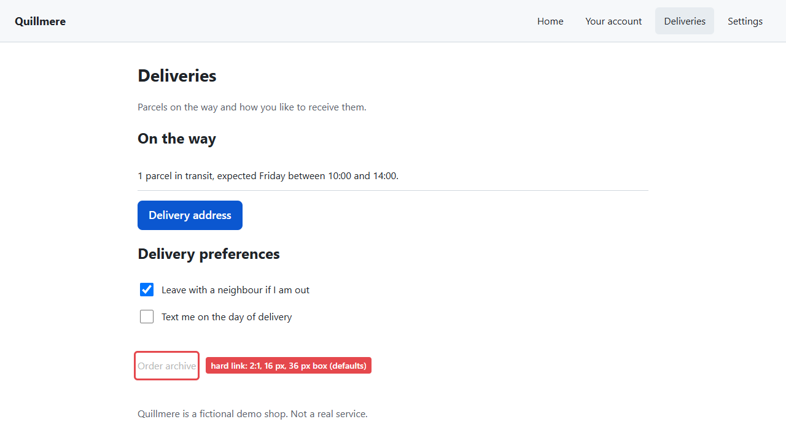

# @wayford/target-app

Quillmere, a small, domain-neutral and fictional "my account" shop to walk. It has one easy goal and one hard one, and query parameters tune the hard link. They set the app, not the persona: the preview sliders and the sweep move a persona's thresholds and leave these fixed (`docs/STACK.md`, "Target app").




```bash
pnpm --filter @wayford/target-app dev
```

Serves on **http://localhost:5174** (`strictPort`, so it fails rather than moving). To serve a production build on the same port instead, stop `dev`, then run `pnpm --filter @wayford/target-app build` and `pnpm --filter @wayford/target-app preview`. `preview` serves the last build; it does not rebuild.

Seeded runs, sweeps and the demo recording use a build (`docs/STACK.md`, "Target app"). `dev` adds Vite's client to every page and injects `style.css` from script. The client keeps a websocket open to the server, swaps the styles when `style.css` changes, and reloads the page when its HTML or a script changes, or after the server restarts. A build links bundled, hashed files in `<head>` and has no client.

## Pages

The URL contract from `tasks/m0-06-target-app.md`, also defined in `src/pages.ts` as `PAGES`:

| Path | File | What it is |
|---|---|---|
| `/` | `index.html` | home, a big "Your account" link |
| `/account` | `account.html` | obvious, well-labelled section |
| `/account/address` | `account/address.html` | **easy goal page** |
| `/deliveries` | `deliveries.html` | misleadingly labelled section: a big "Delivery address" link, and the low-contrast "Order archive" link at the bottom |
| `/deliveries/archive` | `deliveries/archive.html` | **hard goal page**, linked only from `/deliveries` |
| `/settings` | `settings.html` | a plausible wrong turn ("order history" is mentioned, not linked) |

A path that matches no page or file returns 404 (`appType: "mpa"`), never the home page. A trailing slash is no match either: `/account/` and `/deliveries/?contrast=3` return 404 with an empty body, on `dev` and `preview` alike. No redirect adds the slash or strips it, since the app has no router, so links and start URLs use the paths exactly as listed, and only `/` ends in a slash. Both servers also serve the files themselves (`/deliveries/archive.html` returns the archive page), but the goal globs below match only the extensionless paths, so reaching a `.html` file is not success. `src/dev-server.test.ts` checks this on `dev`; `preview` is still checked by hand.

## Goals

Defined in `src/pages.ts` as `GOALS`, a copy of the two tasks in `packages/core/src/fixtures/tasks.json`. `src/goals.test.ts` reads that file and fails when a sentence, a success condition or the order differs. Both succeed on URL alone:

| Goal | Sentence | `urlMatches` | Route |
|---|---|---|---|
| easy | you want to know where your next parcel is going | `**/account/address` | Home → Your account → Delivery address, through large links. Or Home → Deliveries (nav item, or the card's small inline link) → Delivery address (large link). Two clicks either way. |
| hard | you want to see what you ordered three months ago | `**/deliveries/archive` | Home → Deliveries → "Order archive", faint and alone at the bottom |

## Parameters

| Parameter | Default | Range | Sets | Effect |
|---|---|---|---|---|
| `contrast` | `2` | 1–21 | `--fg` (against `--bg`) | WCAG contrast of the hard link text. The grey chosen is the lightest one that reaches the ratio, never below it, so the realised ratio snaps up to the next 8-bit grey. |
| `fontPx` | `16` | 6–72 | `--font-size` | font size of the hard link |
| `targetPx` | `36` | 8–96 | `--target-size` | minimum height and width of the hard link's box: its smaller side whenever the font fits in it |

`--bg` is fixed at `#ffffff`. **Only `.hard-link` reads these variables**, so a change moves one element across a threshold and the rest of the page stays put.

With the defaults, the font meets Vera's 16 px exactly, on purpose (P3 compares with `>=`, and the calibration table in `docs/RULES.md` relies on it), and the target clears her 32 px, so **contrast is the only metric that gates her**, and a sweep of her contrast threshold has a boundary to find. 2:1 sits below her 3:1, inside her softness band, so each run's seed decides whether the link reaches her degraded (name partly masked) or not at all. Milo (target 44) still loses the link on target size; Zoya (7:1, 24 px, 48 px) loses it on all three.

Missing or unparsable values fall back to the defaults, and out-of-range values, infinities included, are clamped.

**Parameters live for the tab.** Put all three on the start URL, e.g. `/?contrast=4.5&fontPx=16&targetPx=36`:

- A URL that sets any parameter decides alone. Parameters it omits take their defaults, and the result is saved to `sessionStorage` under `wayford-target-params`.
- Once saved, the script removes them from the address bar (`history.replaceState`), so the Actor never reads `?contrast=` in a URL. If saving fails they stay, so a reload still renders the same page.
- A URL without parameters uses what the tab saved. So links stay plain paths, goal globs such as `**/deliveries/archive` match after navigation, and the setting survives reloads.
- Because they leave the address bar, after a `goto` that waits for `load` (the default) or `domcontentloaded`, `page.url()` no longer shows the parameters. A harness records the URL it passed to `goto` as the run's parameters, in `startUrl` on `runStarted` and `RunResult` (`@wayford/core`).
- Omitted parameters reset to their defaults, not to what the tab saved, so repeat any non-default value you want to keep.
- Saved parameters belong to the tab, not the browser context: a new tab starts from the defaults. Start every run from a URL that carries all three parameters, so no run depends on what its tab saved and the recorded URL is the whole setting.

## Font

Every glyph on every page comes from one bundled file, `public/fonts/inter-latin-wght-normal.woff2`: Inter 4, variable weight, upright, Latin subset, copied unchanged from `@fontsource-variable/inter` 5.3.0 on npm, under the SIL Open Font License (`public/fonts/OFL.txt`). There is no CDN and no system font, so text metrics no longer depend on the fonts of the machine running the browser (issue #32).

- Page text is printable ASCII plus "·", and the file has all of it; a test checks every page. Any other character would be drawn from a system font, so check the font's coverage before adding one. That is why the Menu button's icon is three bars drawn in CSS, not a "☰" glyph.
- `load` waits for the file: with its download held back 3 s, `goto` returned only after the font had loaded, on the dev server and on a build (Chromium 153). Measure after `load`, Playwright's default for `goto`, never after `domcontentloaded`. `font-display: block` keeps text invisible for up to 3 s rather than paint a fallback first.
- If the file fails to load, the page falls back to a system font and `document.fonts.status` still reads `loaded`. So after `goto` a harness checks `await page.evaluate(() => document.fonts.check('16px "Inter"'))` and fails the run when it is `false`: the page would be measured in the wrong font.
- Layout still depends on the browser build, which Playwright pins per release, and glyph positioning can differ between operating systems. Compare boxes only between runs on the same operating system and browser build. Recording the browser version on the run is issue #64.

## Other properties

- No framework, no router. Plain HTML pages, one script (`src/main.ts`) for the parameters and the menu. Its logic sits in `src/page-script.ts`, tested in `page-script.test.ts`; `dev-server.test.ts` starts Vite and checks that every contract path returns 200 and an unknown path or a trailing slash returns 404.
- Every link, button and checkbox has a visible text name, and no control is icon-only. Sub-pages mark their section in the nav with `aria-current="location"`.
- At widths up to 640 px the nav collapses behind one "Menu" button with a three-bar icon (`aria-expanded`, `aria-controls`). This is here for the knowledge dimension.
- Text is 17 px, headings 28 and 26 px (18 px in cards). Nav items, the Menu button and the buttons are 46 px tall, and the big links are 18 px text in 50 px boxes. Form controls inherit the page font. No fixed size sits on a persona cut (font 16 and 24 px, target 32, 44 and 48 px): on a cut an element passes only because the rules compare with `>=`, and a box there can flip on sub-pixel layout (issue #32). A test keeps it that way. The hard link at its defaults is the one exception, on purpose (see "Parameters").
- Other elements are below Vera's and Milo's target cuts whatever the parameters: the brand link (27 px tall) and the plain text links such as "Go to deliveries" and "Back to deliveries" (20 px). Both goals stay reachable through the nav and the big links. The checkboxes are 22 px, but each sits in a 46 px tall label that toggles it, and a target is the area a click activates (`docs/RULES.md`, P4, #117). So they clear Vera's and Milo's cuts and, at desktop width, stay below Zoya's 48 px.
- Three buttons ("Change delivery address", "Request a copy of my data", "Close my account") do nothing. Neither goal needs them.
- `target-app` imports nothing from the workspace, and no package may import it (`biome.json`). So it has no `src/index.ts`, the barrel the layout in `docs/CONVENTIONS.md` gives a package: its entries are the six HTML pages and `src/main.ts`.
- The `typecheck` script runs two TypeScript programs. `tsconfig.json` holds every file, with node types for the tests and `vite.config.ts`, and it is the one editors open. `tsconfig.browser.json` checks `src` without the tests against browser types only, so page code that uses a Node API such as `process` fails the typecheck, even where an editor shows no error.

Decisions, deviations from the task and open follow-ups: `tasks/m0-06-target-app.md`, sections Outcome and Follow-ups.
